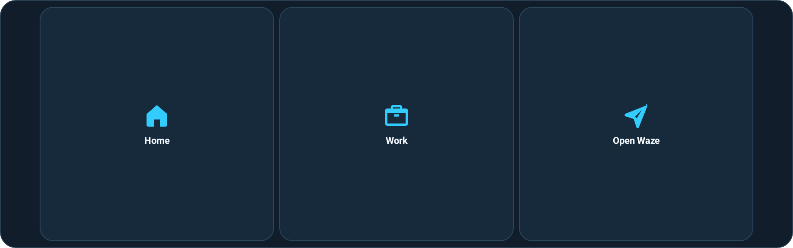

# Quick Route

Quick Route is an Android widget with three Waze actions: Home, Work, and Open Waze. The widget uses three equal square tiles in one row and can be fitted into a compact 2 × 2 area. It is designed for Dashline and also works with Android home screen launchers.



## Install

1. Download the [Quick Route 1.2.0 APK](https://github.com/LuizPT/quick-route-waze-widget/releases/tag/v1.2.0) and open Quick Route once.
2. In Dashline, add **Quick Route** from the widget picker and resize it to the available space. The three tiles stay square as the widget changes size.
3. Install Waze. Home and Work use the destinations saved in your Waze account.

Choose Portuguese or English in the app using the flag buttons. Quick Route follows the device language on first launch and remembers the language selected in the app.

The widget does not read or store destinations and does not request location, network, or other permissions. Home and Work use Waze's supported saved-destination links; Open Waze launches the app.

## Build and validate

Requires JDK 17 or later and Android SDK Platform 37. On Windows, use the included Gradle Wrapper:

```powershell
.\gradlew.bat testDebugUnitTest lint assembleDebug assembleRelease
```

The APK is at `app/build/outputs/apk/release/app-release.apk`. Production code and JVM tests are in `app/src/`. To sign a local build, set `ROTA_RAPIDA_KEYSTORE`, `ROTA_RAPIDA_STORE_PASSWORD`, `ROTA_RAPIDA_KEY_ALIAS`, and `ROTA_RAPIDA_KEY_PASSWORD`. The signing key is stored outside the repository at `%LOCALAPPDATA%\RotaRapidaSigning` and is not included in the source archive.

See [docs/VALIDATION.md](docs/VALIDATION.md) for current build, emulator, and device-test results.
